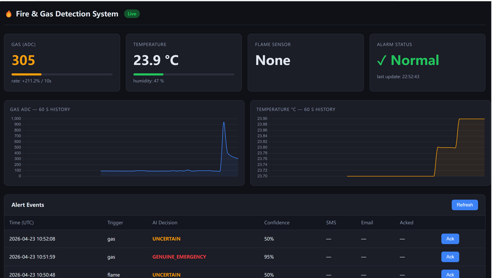
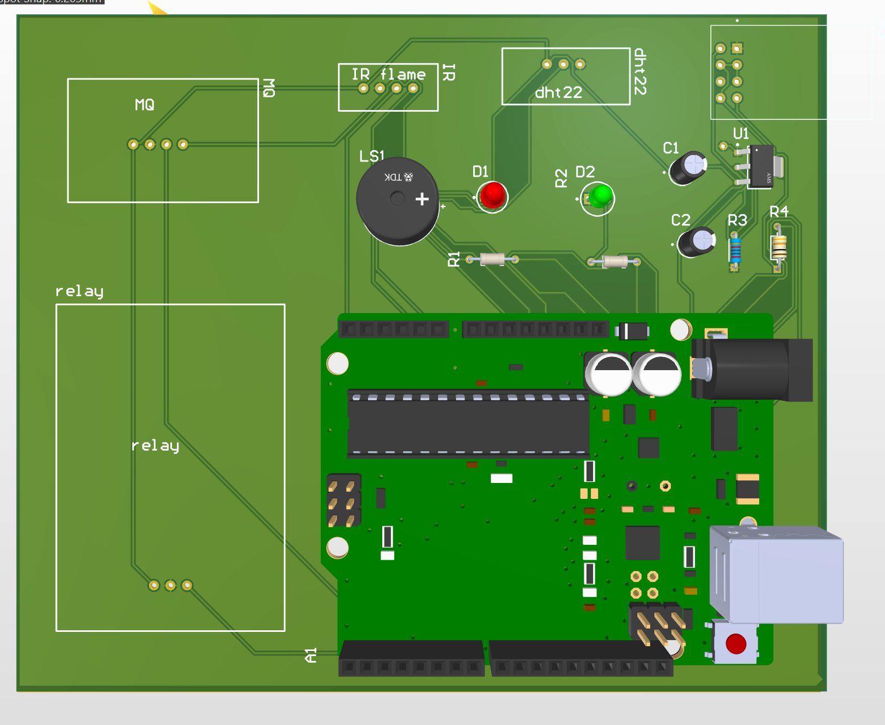
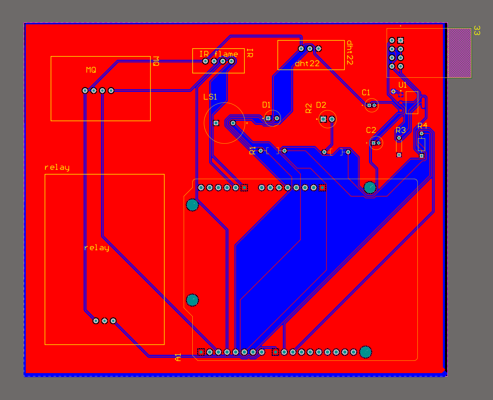
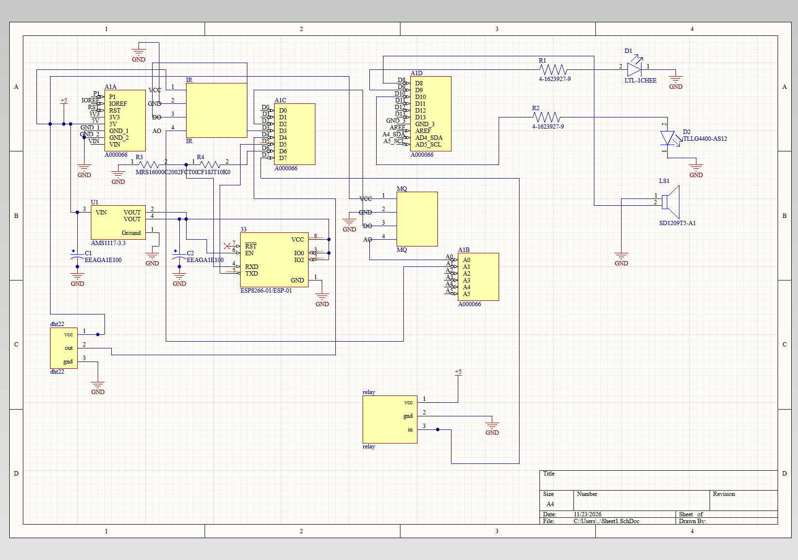

# Intelligent Fire & Gas Detection System

An IoT fire and gas monitoring project using Arduino, ESP-01, Flask, SQLite, Docker, and a real-time web dashboard.

## Features

- Reads gas, flame, temperature, and humidity data from Arduino sensors
- Sends sensor readings from an ESP-01 Wi-Fi module to a Flask REST API
- Stores recent readings and alert events in SQLite
- Displays live status and historical readings on a dashboard
- Supports AI-assisted false-alarm analysis
- Supports SMS and email notification hooks for emergency alerts
- Runs with Docker Compose for simple local deployment

## Dashboard Preview

[](docs/dashboard/dashboard-2026-04-23.png)

Dashboard screenshot captured on 23 April 2026. The display shows gas ADC **305**, temperature **23.9 °C**, humidity **47%**, no flame detected, and a **Normal** current alarm status. The 60-second history charts show a gas reading spike and temperature changes; the alert table includes earlier gas and flame events with classification labels and acknowledgement controls.

The classification labels and confidence values are outputs displayed by the application, rather than independently verified detection accuracy. The SMS and email fields shown contain dashes, so this screenshot does not confirm notification delivery. Click the image to view the original resolution.

## Hardware

- Arduino Uno
- ESP-01 Wi-Fi module
- MQ-2 gas sensor
- IR flame sensor
- DHT11 temperature and humidity sensor
- Relay, buzzer, red LED, and green LED

## Hardware Design Gallery

Altium design screenshots show the schematic, PCB routing, and 3D board view. Click an image to inspect the original resolution.

### PCB 3D View

[](docs/hardware/pcb-3d-view.png)

The 3D view illustrates the Arduino Uno footprint, sensor and relay module connections, buzzer, status LEDs, and ESP-01 power supply components. Module outlines and connectors do not represent a fully assembled physical board.

### PCB Layout

[](docs/hardware/pcb-layout.png)

The layout screenshot documents component placement and routing for the sensor interfaces, alarm outputs, and Wi-Fi module connections.

### Circuit Schematic

[](docs/hardware/schematic.png)

The schematic shows the Arduino Uno interfaces and the AMS1117-3.3 supply for the ESP-01.

**Design revision note:** These screenshots label the temperature/humidity sensor as **DHT22**, while the current Arduino firmware uses `DHT dht(DHT_PIN, DHT11)`. Confirm the fitted sensor and reconcile the schematic, wiring, and firmware before using this hardware revision. These images document a design; they do not establish fabrication, assembly, or hardware test results. Native Altium files and manufacturing outputs are not included in this gallery.

## Project Structure

```text
app.py                         Flask application entry point
server/routes/api.py           REST API endpoints for sensor data and alerts
server/models/database.py      SQLite models
server/services/ai_analyzer.py AI-assisted alarm classification
server/services/notifier.py    SMS and email notification helpers
dashboard/                     Web dashboard templates and static files
arduino/                       Arduino firmware for ESP-01 AT command mode
docs/hardware/                 Schematic, PCB layout, and 3D design screenshots
docs/dashboard/                Dashboard demonstration screenshot
docker-compose.yml             Docker Compose deployment
Dockerfile                     Flask server container image
```

## Setup

Create a local environment file from the example:

```bash
cp .env.example .env
```

Fill in only the services you plan to use. The application can run without notification credentials, but AI and notification features require valid API keys.

## Run With Docker

```bash
docker compose up -d --build
```

Open:

```text
http://127.0.0.1:5000
```

Sensor API endpoint:

```text
POST /api/sensor-data
```

Example payload:

```json
{
  "gas": 320,
  "gas_rate": 2.5,
  "temp": 26.4,
  "hum": 48.0,
  "flame": false,
  "gas_al": false,
  "tmp_al": false,
  "alarm": false
}
```

## ESP-01 Configuration

Before uploading the Arduino sketch, update these values in `arduino/fire_gas_detector_AT/fire_gas_detector_AT.ino`:

```cpp
const char* WIFI_SSID = "your_wifi_name";
const char* WIFI_PASS = "your_wifi_password";
const char* SERVER_IP = "your_computer_lan_ip";
const int SERVER_PORT = 5000;
```

Use the computer's LAN IP address, not `127.0.0.1` and not the Docker container IP.

## Security Notes

Do not commit `.env`, database files, logs, or local cache files. Use `.env.example` to document required variables without exposing credentials.
